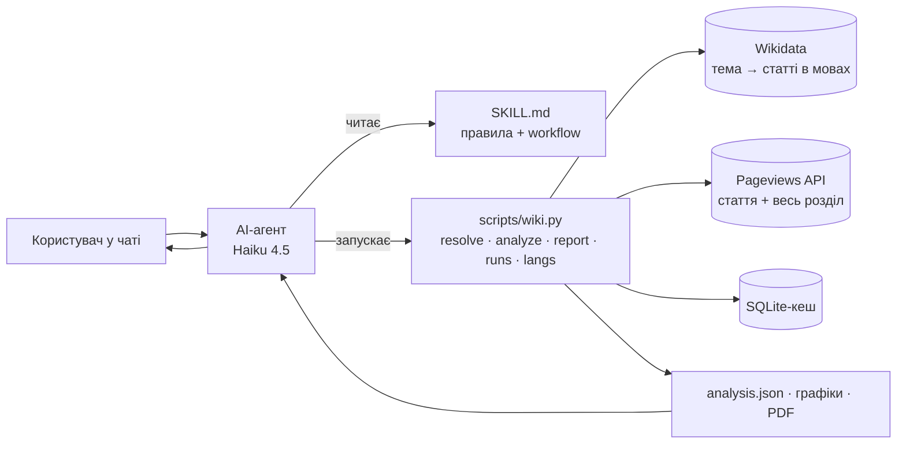

# wiki-interest-research: навичка AI-агента для дослідження інтересу до тем за даними Wikipedia

Навичка у форматі [Agent Skills](https://agentskills.io/specification). З нею агент (зокрема на дешевій моделі на кшталт Claude Haiku 4.5) відповідає засновникам B2C-продуктів на питання «яку тему розвивати далі» та «якою мовою запускатися». Навичка бере статистику переглядів Wikipedia, перевіряє, наскільки можна довіряти тренду, будує графіки й формує PDF-звіт на одну сторінку.

```
Користувач: «Ми думаємо додати курс з астрономії. Чи зростає інтерес до теми в україномовній Wikipedia і наскільки цьому можна довіряти?»
Агент:      resolve → analyze → відповідь з цифрами, рівнем довіри й обмеженнями → (за потреби) report → PDF
```

> Інтерфейсом є чат агента, окремого UI немає. Агент читає `SKILL.md`, а всю роботу з даними виконує код навички.

---

## Зміст
1. [Продуктова рамка](#1-продуктова-рамка)
2. [Як це працює](#2-як-це-працює)
3. [Встановлення й запуск](#3-встановлення-й-запуск)
4. [Що показали приклади з кейсу](#4-що-показали-приклади-з-кейсу)
5. [Методологія та модель довіри](#5-методологія-та-модель-довіри)
6. [Як навичка допомагає дешевій моделі](#6-як-навичка-допомагає-дешевій-моделі)
7. [Повторні та пов'язані запити](#7-повторні-та-повязані-запити)
8. [Перевірка якості](#8-перевірка-якості)
9. [Як я використовував AI і як перевіряв результат](#9-як-я-використовував-ai-і-як-перевіряв-результат)
10. [Обмеження](#10-обмеження)
11. [Як розвивати навичку далі](#11-як-розвивати-навичку-далі)
12. [Структура репозиторію](#12-структура-репозиторію)

---

## 1. Продуктова рамка

**Користувач:** засновник або продакт B2C-застосунку (освіта, здоров'я, мови), який вирішує, куди вкласти наступний спринт чи бюджет локалізації.

**Рішення, яке підтримує навичка:** не «запускати чи ні», а **що перевіряти далі**. Інтерес до статті у Wikipedia ще не означає попиту на продукт. Проте це дешевий, публічний і мультимовний сигнал, щоб:
- відсіяти гіпотези, де інтерес стабільно падає;
- порівняти мовні аудиторії однією метрикою;
- знайти мови, де теми взагалі немає: це або низький інтерес, або незайнята ніша.

**Що вважається «перспективним»** залежить від користувача. Тому рейтинг мов має ваги (`--weights growth=2,size=1,intensity=1,trust=1`): кому важливіше зростання, кому розмір аудиторії.

**Головний принцип:** кожна рекомендація спирається на числа з коду і має явний рівень довіри та обмеження. Агент не рахує і не вигадує числа сам.

## 2. Як це працює



1. **`resolve`**: назва теми будь-якою мовою → поняття у Wikidata (QID) → назва статті в кожній мові. Неоднозначні назви («Меркурій») і мови без статті позначаються явно.
2. **`analyze`**: місячні перегляди статей (разом із редиректами) і всього мовного розділу. Далі рахуються метрики, рівень довіри, рейтинг мов, будуються графіки. Результат зберігається як *run* у `./wiki-reports/<run-id>/`.
3. **Агент відповідає** за шаблоном із `SKILL.md`: коротко, цифри, наскільки довіряти, обмеження, що далі.
4. **`report`**: PDF на 1 сторінку + Markdown. Таблицю, графіки, знахідки й методологію генерує код, агент пише лише висновок (до 700 символів). Числа у висновку автоматично звіряються з даними.

## 3. Встановлення й запуск

Потрібні Python 3.10+ та інтернет. Інші залежності (`numpy`, `matplotlib`, `fpdf2`, `certifi`, версії закріплені в `requirements.txt`) ставляться автоматично в `.venv` під час першого запуску, це приблизно 20–60 с.

```bash
git clone <цей репозиторій> && cd wiki-interest-skill
# Claude Code: навичка для всіх проєктів
ln -s "$PWD/wiki-interest-research" ~/.claude/skills/wiki-interest-research
# або тільки для одного проєкту: <project>/.claude/skills/wiki-interest-research
```

Далі достатньо поставити агенту питання звичайною мовою. CLI можна запускати й вручну:

```bash
python3 wiki-interest-research/scripts/wiki.py resolve "інтервальне голодування" --lang uk --langs pl,cs
python3 wiki-interest-research/scripts/wiki.py analyze --qid Q1666254 --langs pl,cs --months 24
python3 wiki-interest-research/scripts/wiki.py report --run intermittent --lang uk --conclusion "..."
```

Повний опис команд: [`references/cli-reference.md`](wiki-interest-research/references/cli-reference.md).

## 4. Що показали приклади з кейсу

Дані за 2024-09 — 2026-08 (24 повні місяці), отримані 23.09.2026.

**«Порівняй зростання інтересу до інтервального голодування в pl і cs за два роки»**
- У **польській Wikipedia статті про інтервальне голодування немає** (у чеській і українській є). Навичка повідомляє про це як про окрему знахідку й не підставляє мовчки іншу статтю.
- Чеська: з поправкою на трафік розділу **−47%**, лише 1 з 12 місяців вищий за торішній, довіра **середня** (усі 4 перевірки пройдено, але обсяг малий: ~231 перегляд на місяць). У квітні 2025 був новинний сплеск (4,1× медіани).

**«Курс з астрономії: чи зростає інтерес в uk і наскільки довіряти?»**
- Стаття «Астрономія» має сильну сезонність: вересень у 2,6 раза вищий за жовтень, бо стартує навчальний рік. Тому порівнюються однакові календарні місяці, а не «перший проти останнього».
- Одна стаття дає −46% (довіра середня, ~611 переглядів на місяць). **Кошик** із 4 статей (Астрономія, Сонячна система, Чорна діра, Телескоп) дає −34% (довіра висока, ~7 170 переглядів на місяць). Відповідь така: інтерес у Wikipedia падає навіть з поправкою на спад трафіку всього розділу (−25%), тому курс варто валідувати іншими джерелами.

**«Застосунок для вивчення мов: інтерес до англійської в pl, de, tr, es, uk, it, які аудиторії досліджувати далі?»**
- Сирі перегляди статті «Англійська мова» падають у **всіх** 6 мовах (−7…−35%). Проте **трафік самих розділів теж падає (−7…−25%)**. Після поправки видно, що в tr і de інтерес **стабільний (+0%)**, а в uk (−14%), it (−19%) і pl (−10%) справді знижується.
- Рейтинг (відносний, з вагами за замовчуванням): de > tr > es > uk > pl > it. Приклад PDF: [`evals/examples/`](wiki-interest-research/evals/examples/).

Найважливіше спостереження кейсу: **без нормалізації на трафік розділу майже будь-яка тема виглядає як «спадаюча»**. Це був перший реальний баг методології, який я знайшов під час перевірки (див. §9).

## 5. Методологія та модель довіри

Детально з усіма порогами: [`references/methodology.md`](wiki-interest-research/references/methodology.md). Коротко:

| Що | Як | Навіщо |
|---|---|---|
| Джерело | Pageviews API, `agent=user`, усі пристрої, лише повні місяці | без відомих ботів і без неповного поточного місяця |
| Зіставлення мов | Wikidata sitelinks | те саме поняття в різних мовах, навіть коли назви різні |
| Редиректи | перегляди до 25 редиректів додаються | перейменовані статті не «обвалюють» ряд |
| **Скоригована зміна** (головна) | частка теми в усіх переглядах розділу, останні 12 міс проти попередніх 12 | відокремлює інтерес до теми від падіння трафіку Wikipedia; сезонність нейтралізується |
| Послідовність | у скількох з 12 місяців частка вища, ніж торік | «росте стабільно» проти «виріс за рахунок одного місяця» |
| Стійкість до піків | зміна без 2 найбільших місяців + детектор сплесків (MAD) із розрізненням сезонних і новинних | вірусний місяць не видається за тренд |
| Тренд | Theil–Sen на десезоналізованому log(частки) + тест Манна–Кендалла | робастна оцінка %/рік і перевірка значущості |
| Інтенсивність | переглядів на 1 млн переглядів розділу | порівняння мов різного розміру |

**Рівень довіри** (high / medium / low) визначається часткою пройдених перевірок: послідовність, стійкість до піків, узгодженість із сирими переглядами, значущість тренду. Далі він обмежується «стелею» за якістю даних: малий обсяг, період <24 міс, частка ботів >20%, стаття створена чи перейменована в періоді, неповний кошик. Кожна перевірка виводиться з ✓/✗, тому і користувач, і агент бачать, **чому** рівень саме такий.

## 6. Як навичка допомагає дешевій моделі

Вимога кейсу — зручність для Haiku 4.5. Рішення:

- **Уся змістовна робота в коді.** Агент лише обирає команду й пояснює результат. Жодного «напиши скрипт сам».
- **Мало кроків.** Типовий сценарій — 2–3 виклики (`resolve` → `analyze` → `report`). Кожен вивід закінчується рядком `next:` із готовою командою та абсолютним шляхом.
- **Компактний вивід.** Markdown-таблиця на ~30 рядків замість сирого JSON (`--json` лишається опційним). Це економить токени й зменшує плутанину.
- **DRAFT FACTS мовою користувача.** Код сам пише фактичну частину відповіді: напрям і довіру по кожній мові, причини довіри, розмір аудиторій, сплески, обмеження. Агент копіює ці речення і додає рекомендацію. Саме це підняло якість з «суддя знайшов помилки в 4 з 6 ходів» до «в 2 з 6» (див. §8).
- **ANSWER CHECKLIST у кінці кожного виводу.** Там перелічено, що точно має бути у відповіді: напрям і довіра по мовах, порядок рейтингу, обране значення неоднозначної назви, обмеження, «не називай нічого зростанням, якщо росту немає». Малі моделі найкраще виконують останні інструкції в контексті.
- **Правила в `SKILL.md`**: числа тільки з виводу; «зростає/спадає» тільки за полем `direction`; при низькій довірі казати «даних недостатньо»; відсутність статті є знахідкою; обмеження обов'язкові.
- **Автоперевірка висновку.** `report` знаходить у тексті агента кожне `N%`, `N/12` і кількість переглядів та звіряє їх із метриками. Також він ловить слова «зростання/росте», коли жодна мова не зростає. Якщо щось не так, виводиться `WARNING`, і агент перезапускає команду з виправленим текстом.
- **Неоднозначність виявляє код.** `analyze` шукає інші популярні поняття з тією ж назвою (Меркурій: планета / хімічний елемент) і вимагає назвати обране значення.
- **Зрозумілі помилки.** `ERROR: …` + підказка, що робити далі. Мережеві збої та 429 повторюються автоматично.
- **Progressive disclosure.** `SKILL.md` займає ~90 рядків, деталі лежать у `references/` і читаються лише за потреби.
- **Мова `SKILL.md`: англійська**, бо це інструкція для моделі (менше токенів і стабільніше слідування інструкціям). Українською написані звіти, відповіді користувачу, README та тригери в `description`.

## 7. Повторні та пов'язані запити

- **SQLite-кеш HTTP-відповідей** (`~/.cache/wiki-interest-research/`). Закриті місяці зберігаються 60 днів, свіжі 1 день. Повторний `analyze` з тими ж даними робить **0 запитів**, а при додаванні мови завантажується лише ця мова.
- **Runs.** Кожен аналіз зберігається (`analysis.json` + графіки). `runs list / show` дає агенту змогу згадати, що вже дивилися, без перерахунку.
- **Уточнення** на кшталт «додай словацьку», «а за 5 років», «зростання важливіше за розмір» виконуються як той самий `analyze` зі зміненими прапорцями (`--langs`, `--months 60`, `--weights`). У `SKILL.md` є готові відповідники.
- **`langs --qid …`** показує, у яких великих Wikipedia стаття існує і скільки має переглядів. Це допомагає, коли користувач питає «які аудиторії ще дослідити».

## 8. Перевірка якості

| Рівень | Що перевіряється | Статус |
|---|---|---|
| Unit-тести (`pytest`, 34 шт., офлайн) | метрики на синтетичних рядах із відомою відповіддю (тренд + сезонність, лише сезонність, падіння всього розділу, один вірусний місяць, малий обсяг, нова стаття, короткий період); API-особливості (404 → нулі, пропущені місяці, кодування назв, коди мов); вибір поняття при неоднозначності; наскрізний пайплайн на фейковому API → PDF на 1 сторінку; детектор вигаданих чисел | ✅ |
| Звірка з сирим API | для «Астрономія» (uk) усі 24 місяці збігаються з прямим запитом до API, редирект додає рівно свої 2 перегляди; −60% сирих переглядів підтверджено вручну | ✅ |
| Формат навички | `skills-ref validate wiki-interest-research` → `Valid skill` | ✅ |
| Середовище | bootstrap з нуля на Python 3.14 і 3.13 (macOS); піни для 3.10–3.11 задані маркерами, але локально не запускалися | ✅ / ⚠️ |
| **E2E на Haiku 4.5** | `evals/run_haiku.sh`: 4 сценарії (3 з кейсу + неоднозначна тема) + 2 follow-ups у чистій папці, де встановлена лише ця навичка; `evals/check.py`: 38 автоперевірок + LLM-суддя, який бачить той самий вивід CLI | 4 ітерації: автоперевірки 32 → 36 → 38 → **38/38**; суддя: ходів без суттєвих помилок 2/6 → **4/6**. Деталі й відповіді: [`evals/results.md`](wiki-interest-research/evals/results.md) |

Як запустити:
```bash
cd wiki-interest-research
.venv/bin/pip install -r requirements-dev.txt && .venv/bin/python -m pytest -q tests
./evals/run_haiku.sh                       # потрібен залогінений claude CLI
.venv/bin/python evals/check.py evals/.runs/<stamp> --judge
```

## 9. Як я використовував AI і як перевіряв результат

**Інструменти:** Claude Code (Opus) для дослідження API, архітектури та коду; Claude Haiku 4.5 як агент, що користується навичкою, в evals; Sonnet як LLM-суддя.

**Процес:** спершу план і живі запити до API, потім реалізація, потім перевірка на реальних даних і виправлення. Кожне рішення я перевіряв фактами, а не довірою до згенерованого коду:

1. **Живі запити до API ще до написання коду.** Так знайшлися особливості, які змінили дизайн: 404 означає «нуль переглядів», а не помилку; нульові місяці відсутні у відповіді; у plwiki немає статті про інтервальне голодування; сильна сезонність астрономії; пошук «Mercury» першою видає автомобільну марку.
2. **Звірка чисел навички з сирим API** (див. §8).
3. **Читання кожного графіка й PDF очима**, зокрема рендер кирилиці та діакритики, перекриття легенди й обрізаних заголовків.
4. **Тести з відомою відповіддю.** Синтетичний ряд з +40% на рік має дати «growing / high», а падіння теми разом із розділом має дати «stable».

**Реальні проблеми, які знайшла перевірка (і які AI не помітив сам):**

| Проблема | Як виявив | Рішення |
|---|---|---|
| Майже всі теми «спадали» з високою довірою | прогін 6 мов для «англійської»: tr −16%, хоча весь розділ теж −16% | головна метрика стала частка теми в розділі («скоригована зміна») |
| Агент (у моєму ж тестовому висновку) написав «німецька найбільша за обсягом», хоча іспанська більша | ручне читання PDF | автоперевірка чисел у висновку + правило «тільки факти з findings» |
| Підказки для відсутньої статті були сміттям («Španielsko» для інтервального голодування) | ручний прогін sk | фільтр за спільною основою слова: краще без підказки, ніж хибний проксі |
| `CERTIFICATE_VERIFY_FAILED` на macOS Python | перший запуск | `certifi` як закріплена залежність |
| `numpy.bool_` ламав збереження JSON | перший запуск analyze | нормалізація типів перед записом |
| −10% показувалося як «стабільний» (−9,96%) | читання таблиці | напрям визначається за округленим значенням, яке бачить читач |
| Поріг «малий обсяг» був надто суворим (231/міс при однозначному спаді давав low) | порівняння з Poisson-шумом | пороги 100 / 1000 переглядів на місяць |
| Два `analyze` в одну секунду отримували однаковий run-id, і другий **перезаписував** перший | автоперевірка висновку: числа кошика не збіглися із завантаженим run | унікальний суфікс run-id + регресійний тест |
| Якісне твердження у висновку («пік щороку у вересні») стосувалося окремої статті, а не кошика | ручне читання PDF: перевірка чисел такого не ловить | правило в `SKILL.md`: лише факти з findings; LLM-суддя в evals перевіряє саме такі помилки |

**Що знайшли прогони на Haiku** (повний список у [`evals/results.md`](wiki-interest-research/evals/results.md)):
- Haiku **друкував команду текстом** і чекав, замість виконати її → правило «виконуй сам» у `SKILL.md`.
- Haiku намагався `cd` у папку навички → абсолютні шляхи в рядках `next:` і правило «не робити cd».
- Коли агент робив PDF, він пропускав рівень довіри й обмеження в чаті, а `stable` називав «зростанням» → ANSWER CHECKLIST і перевірка формулювань.
- Haiku вигадував абсолютні числа й плутав рівні довіри між мовами → DRAFT FACTS і перевірка абсолютних чисел.
- **Помилки в самих evals:** оцінювач брав run з іншого ходу, суддя спершу бачив неповні дані (хибні «вигадані p-values»), а переписування функції випадково видалило `cmd_analyze`. Усі три виправлено; для останнього додано smoke-тест CLI.

## 10. Обмеження

- **Інтерес до статті не дорівнює попиту на продукт і не означає готовності платити.** Це сигнал для вибору, що перевіряти далі, а не для рішення про запуск.
- **Мовний розділ не дорівнює країні.** Іспанська Wikipedia охоплює Іспанію та Латинську Америку, англійська — весь світ.
- **Трафік Wikipedia змінюється структурно** (AI-асистенти, пошукові сніпети). Нормалізація це компенсує, але не повністю: можливо, одні теми «йдуть в AI» швидше за інші.
- Частина ботів класифікується як `user`, тому детектор сплесків і частка `automated` лише пом'якшують, а не усувають проблему.
- Одна стаття — лише проксі теми. Кошики допомагають, але поки їх обирає агент вручну.
- Mann–Kendall на місячних даних дає оптимістичні p-values через автокореляцію, тож це лише одна з чотирьох перевірок.

## 11. Як розвивати навичку далі

Порядок — за співвідношенням цінності та вартості.

**Ітерація 1. Якість відповіді на базові запити (дешево, одразу)**
- Розширити evals: 20–30 реальних формулювань від засновників, «важкі» мови (zh, ar), неоднозначні теми, кілька прогонів на кейс (варіативність моделі). Запускати їх у CI на кожну зміну `SKILL.md`, стежити за кількістю tool calls і вартістю.
- Команда `check --run … --text "<чернетка відповіді>"`: та сама перевірка чисел і формулювань, але для відповіді в чаті, а не лише для висновку PDF. Це закриває залишкові помилки з evals.
- Автокошик теми: зі зв'язків Wikidata (`part of`, `subclass of`, `main subject`) і категорій автоматично пропонувати 3–7 статей для широких тем («курс астрономії»).

**Ітерація 2. Складніші дослідження**
- **Географія:** endpoint переглядів за країнами (`top-per-country`, `pageviews per country`), щоб відповідати «Бразилія чи Португалія», а не «португальська».
- **Порівняння тем між собою** (астрономія vs біологія в одній мові) та матриця «теми × мови» для вибору наступного курсу.
- **Кращий аналіз:** STL-декомпозиція, детекція точок зламу (коли саме почався ріст), bootstrap-інтервали, короткий прогноз.
- **Clickstream-дані Wikimedia:** звідки приходять читачі (пошук, інші статті). Це проксі наміру «хочу вчитися» проти «просто цікаво».
- **Тріангуляція:** Google Trends, пошукові підказки, App Store / Google Play, Reddit. Рівень довіри росте, якщо джерела згодні.

**Ітерація 3. Більші обсяги даних**
- Для сотень тем × десятків мов API на кожну статтю стає вузьким місцем. Потрібні **pageview dumps** (щомісячні файли по всіх статтях) → Parquet + DuckDB, інкрементальне оновлення й аналіз SQL-запитами замість тисяч HTTP-викликів.
- Фонові пакетні задачі з прогресом і відновленням, щоб агент не чекав синхронно.
- Кеш на рівні агрегатів (topic × lang × month) замість HTTP-відповідей.

**Ітерація 4. Продуктова інтеграція**
- Журнал гіпотез: кожен run прив'язується до гіпотези з рішенням і результатом A/B-тесту. Так з'являється петля «сигнал Wikipedia → реальна конверсія», на якій калібруються ваги рейтингу.
- MCP-сервер з тими самими командами для агентів без shell-доступу; шаблони звітів (1 сторінка / deep dive).

## 12. Структура репозиторію

```
wiki-interest-research/            ← навичка (усе своє — тут)
├── SKILL.md                       ← інструкція для агента
├── requirements.txt               ← закріплені залежності (requirements-dev.txt — для тестів)
├── scripts/wiki.py                ← точка входу: сама створює .venv і запускає CLI
├── wikiinterest/                  ← код
│   ├── api.py, cache.py           ← HTTP: User-Agent, retry/backoff, SQLite-кеш
│   ├── resolve.py                 ← тема → Wikidata → статті в мовах, неоднозначність, підказки
│   ├── fetch.py                   ← ряди переглядів (+редиректи, нулі, розділ, боти)
│   ├── analyze.py                 ← метрики, напрям, довіра, рейтинг
│   ├── pipeline.py                ← оркестрація, збереження runs
│   ├── charts.py, report.py       ← графіки, PDF/Markdown, перевірка висновку
│   ├── i18n.py, cli.py            ← тексти uk/en, CLI
├── references/                    ← методологія, CLI, нотатки про API (читаються на вимогу)
├── tests/                         ← pytest (офлайн)
└── evals/                         ← сценарії Haiku, запуск, оцінювання, результати, приклади PDF
```
